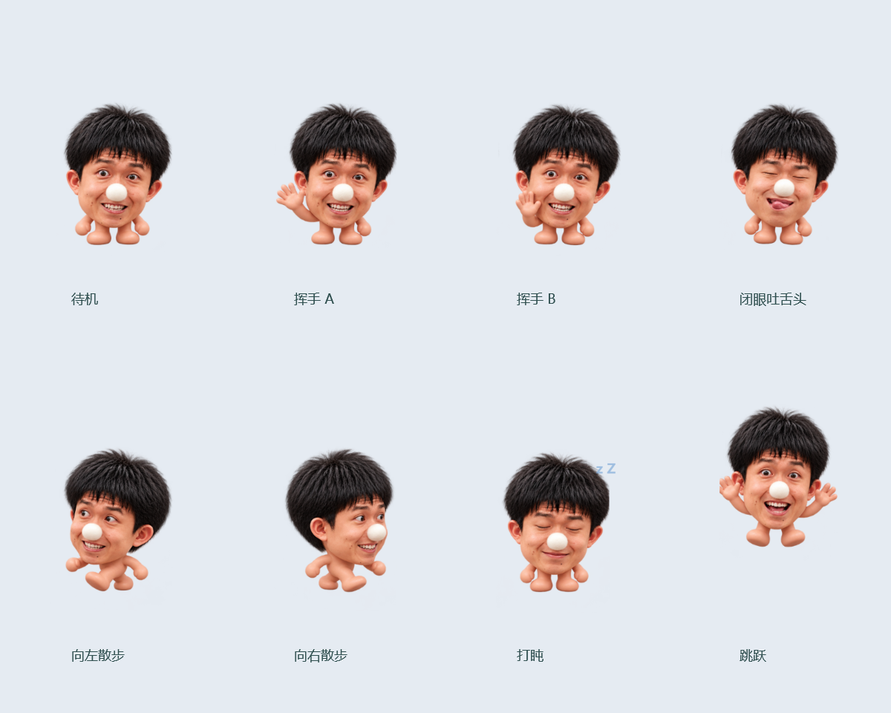
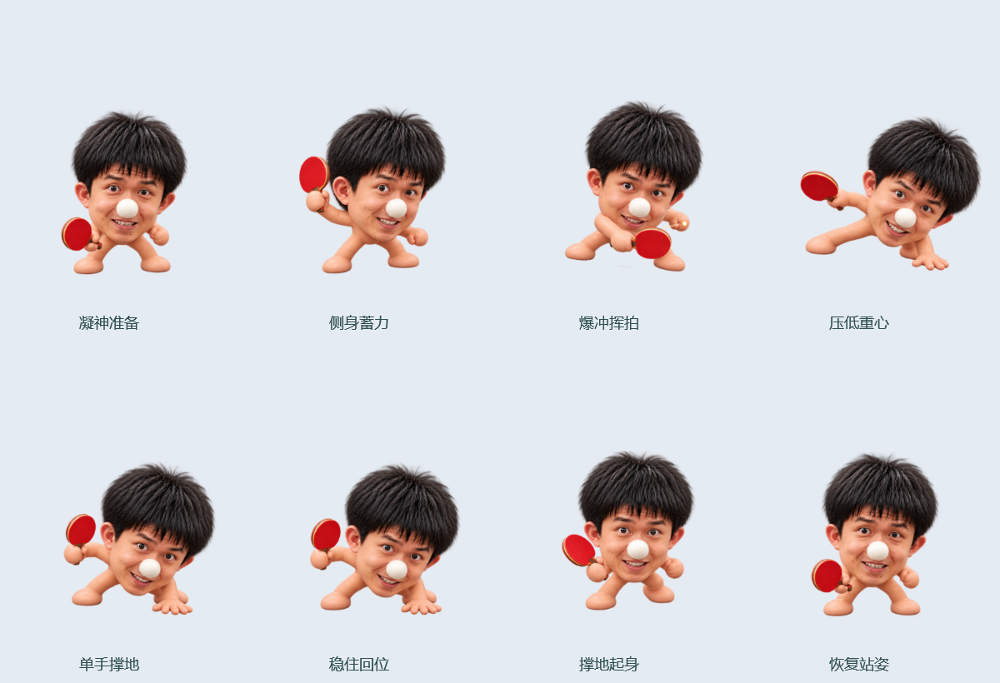

# 白鼻子桌宠

一个可独立运行的 Windows 桌宠，支持挥手、跳跃、吐舌头、散步、打盹和乒乓动作。使用 C#、WPF 和系统自带的 .NET Framework 4.x。

## 下载与启动

从 [Releases](https://github.com/grayander/white-nose-pet/releases/latest) 下载压缩包并完整解压，然后双击 **启动或关闭桌宠.exe**。

也可以点击仓库的 **Code → Download ZIP**，解压后运行同一个程序。请让 `assets` 文件夹与程序保持在同一目录。

适用 Windows 10 / Windows 11。程序不联网、不开机自启、不写注册表、不监听键盘，无需额外安装。

再次双击程序即可关闭桌宠，也可以通过桌宠或系统托盘的右键菜单退出。

## 互动方式

| 操作 | 功能 |
| --- | --- |
| 单击 | 挥手打招呼，气泡文字循环切换 |
| 双击 | 连续跳两下 |
| 按住左键拖动 | 移动桌宠 |
| 鼠标停在桌宠上滚动滚轮 | 调整大小 |
| 右键 | 选择动作、暂停、开关自动散步、设置大小或退出 |

闲置时会随机挥手、跳跃、闭眼吐舌头、散步、打盹、点头，或表演乒乓动作。找不到桌宠时，可在系统托盘菜单选择“回到屏幕右下角”。

乒乓动作包括“侧身爆冲 · 撑地回位”和“滑步救球 · 单手撑地”。

## 动作预览





## 从源码编译

在 Windows PowerShell 中，从项目根目录运行：

```powershell
powershell -NoProfile -ExecutionPolicy Bypass -File .\source\build.ps1
```

编译脚本使用系统的 .NET Framework 4.x 编译器，生成 `启动或关闭桌宠.exe` 和程序图标。

## 文件说明

| 路径 | 内容 |
| --- | --- |
| `启动或关闭桌宠.exe` | 可直接运行的程序 |
| `assets/` | 透明角色图集和程序图标 |
| `source/Pet.cs` | 完整 C# 源码 |
| `source/build.ps1` | 编译脚本 |
| `source/*说明.txt` | 素材制作与面部校准说明 |
| `使用说明.txt` | 详细使用说明 |
| `data/` | 运行时自动生成的本地设置 |

本地位置、大小和散步设置保存在 `data/settings.xml`，不纳入仓库。整个文件夹可以移动；移动前请先退出桌宠。删除文件夹即可卸载。

角色素材依据参考图通过生成式重绘制作，制作说明保存在 `source/` 中。
